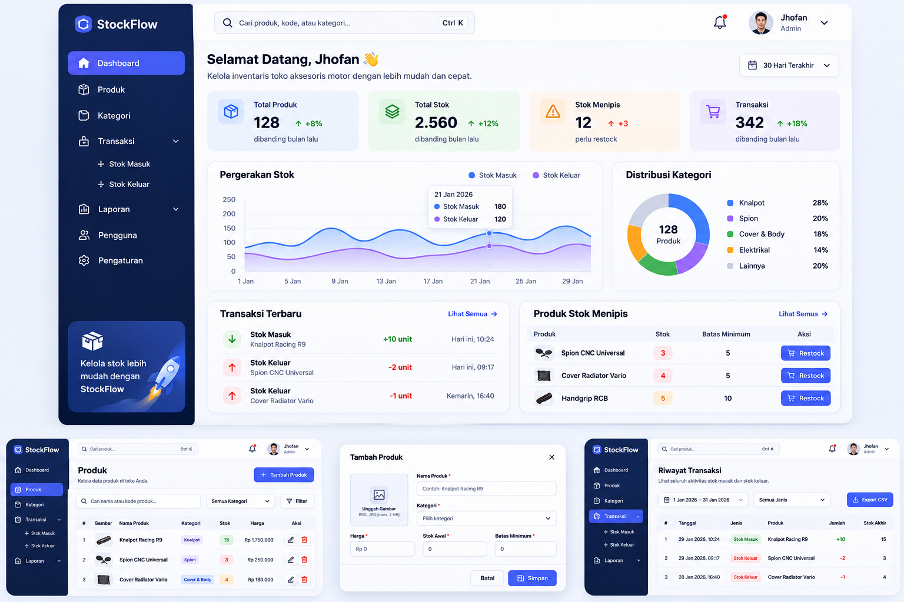
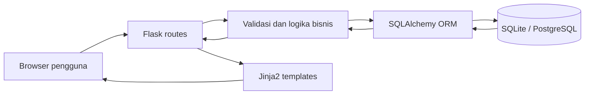
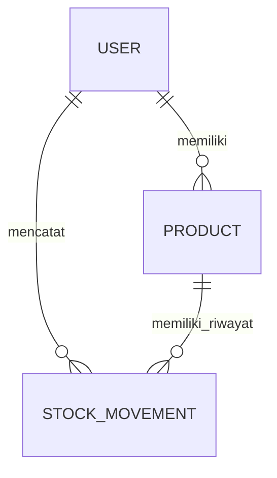

<div align="center">
  
  <h1>StockFlow</h1>
  <p><strong>Inventory Management System</strong></p>
  <p>Aplikasi web untuk mengelola persediaan barang, memantau pergerakan stok, dan melihat laporan inventaris dalam satu dashboard.</p>

  
  
  
  
  

  <p><a href="#fitur-utama">Fitur</a> · <a href="#instalasi">Instalasi</a> · <a href="#akun-demo">Akun demo</a> · <a href="#pengujian">Pengujian</a> · <a href="#deployment">Deployment</a></p>
</div>

---

## Tentang proyek

StockFlow adalah aplikasi manajemen inventaris berbasis web yang dirancang untuk membantu usaha kecil, seperti toko part dan aksesoris motor, mencatat stok barang secara lebih terstruktur. Aplikasi ini menyediakan pengelolaan produk, transaksi stok masuk dan keluar, serta ringkasan inventaris dalam antarmuka yang responsif.

Proyek ini dikembangkan sebagai portofolio pembelajaran Python dan backend development, dengan fokus pada CRUD, pengelolaan database, autentikasi, validasi data, dan pengujian otomatis.

## Preview desain



*Referensi desain awal StockFlow (mockup); bukan tangkapan layar aplikasi yang sedang berjalan.*

<!-- Setelah mengambil screenshot aplikasi yang sebenarnya, simpan di docs/dashboard.png dan ganti gambar di atas dengan screenshot tersebut. -->
<!-- Setelah deployment berhasil, tambahkan tautan Live Demo yang aktif di bagian atas README ini. -->

## Fitur utama

| Fitur | Deskripsi |
| --- | --- |
| Dashboard | Ringkasan jumlah produk, total stok, stok menipis, aktivitas terbaru, dan grafik pergerakan stok 14 hari. |
| Manajemen produk | Tambah, tampilkan, edit, dan arsipkan produk menggunakan SKU unik per pemilik. |
| Pencarian & filter | Cari berdasarkan nama atau SKU, filter kategori dan status stok, serta pagination. |
| Stok masuk & keluar | Catat perubahan stok dengan validasi jumlah dan stok tersedia. |
| Riwayat transaksi | Lihat catatan stok sebelum dan sesudah perubahan serta ekspor CSV. |
| Laporan inventaris | Ringkasan nilai persediaan, aktivitas stok 30 hari, dan kategori produk. |
| Autentikasi | Login dan logout, password hashing, pemeriksaan akses pemilik data, serta proteksi CSRF untuk formulir POST. |
| Desain responsif | Sidebar mobile, mode terang/gelap, grafik, dan notifikasi. |

## Tech stack

| Bagian | Teknologi |
| --- | --- |
| Backend | Python, Flask |
| ORM | Flask-SQLAlchemy, SQLAlchemy |
| Database | SQLite (lokal), PostgreSQL (opsional untuk hosting) |
| Frontend | HTML, Jinja2, CSS, JavaScript |
| Visualisasi & ikon | Chart.js, Lucide |
| Testing | unittest |
| Deployment | Gunicorn, Render, Neon PostgreSQL |
| Version control | Git & GitHub |

## Cara kerja



Ketika pengguna mencatat stok keluar, backend memvalidasi jumlah barang dan memeriksa ketersediaan stok. Jika valid, perubahan persediaan dan riwayat transaksi disimpan dalam satu transaksi database. Stok yang tidak mencukupi ditolak agar persediaan tidak menjadi negatif.

### Model database



- `User` — akun dan kredensial pengguna yang sudah di-hash pada bagian password.
- `Product` — SKU, nama, kategori, harga, jumlah stok, dan batas minimum stok.
- `StockMovement` — jenis transaksi, jumlah, stok sebelum dan sesudah, waktu, dan catatan.

## Instalasi

### Prasyarat

- Python 3.11 atau lebih baru (disarankan Python 3.12).
- Git, jika mengunduh melalui clone repository.
- VS Code atau editor kode lain.

### 1. Unduh source code

Clone repository ini dari GitHub menggunakan URL yang terdapat pada tombol **Code** di halaman repository, atau gunakan **Download ZIP** dan ekstrak foldernya.

Buka terminal dari folder proyek yang berisi `app.py` dan `requirements.txt`.

### 2. Buat dan aktifkan virtual environment

**Windows (PowerShell):**

```powershell
python -m venv .venv
.\.venv\Scripts\Activate.ps1
```

**macOS / Linux:**

```bash
python3 -m venv .venv
source .venv/bin/activate
```

Jika `.venv` untuk proyek ini sudah tersedia, cukup aktifkan tanpa membuat ulang.

### 3. Instal dependensi

```bash
python -m pip install -r requirements.txt
```

### 4. Siapkan database dan data demo

```bash
python -m flask --app app init-db
```

Perintah ini membuat tabel SQLite, akun demo, dan contoh produk. Data lama tidak dihapus jika akun demo sudah tersedia.

### 5. Jalankan aplikasi

```bash
python -m flask --app app run --debug
```

Buka **[http://127.0.0.1:5000](http://127.0.0.1:5000)** di browser.

Mode debug digunakan hanya saat pengembangan lokal. Untuk menjalankan aplikasi kembali setelah instalasi, aktifkan virtual environment dan jalankan perintah Flask pada langkah 5.

## Akun demo

| Field | Value |
| --- | --- |
| Email | `demo@stockflow.local` |
| Password | `Demo12345!` |

Akun demo dibuat saat menjalankan `init-db` dan hanya ditujukan untuk penggunaan dengan data fiktif.

### Mencoba aplikasi

1. Masuk menggunakan akun demo.
2. Tambahkan produk di menu **Produk**.
3. Catat stok masuk atau stok keluar.
4. Periksa perubahan stok dan riwayat transaksi.
5. Lihat laporan atau unduh transaksi sebagai CSV.

## Pengujian

Jalankan pengujian otomatis dengan:

```bash
python -m unittest discover -s tests -v
```

Terdapat 12 skenario pengujian, termasuk autentikasi, pembuatan produk, SKU duplikat, stok masuk/keluar, penolakan stok yang tidak mencukupi, pengarsipan, validasi CSRF, dan ekspor CSV. Pengujian menggunakan SQLite sementara sehingga tidak mengubah data inventaris lokal.

## Struktur proyek

```text
stockflow/
├── app.py                  # Model database, routes, auth, dan logika bisnis
├── templates/              # Halaman HTML/Jinja2
├── static/
│   ├── css/style.css       # Tampilan dan tema
│   ├── js/main.js          # Interaksi antarmuka dan grafik
│   └── img/logo.svg        # Logo aplikasi
├── tests/test_app.py       # Automated tests
├── docs/design-reference.png
├── requirements.txt        # Dependensi Python
├── .env.example            # Contoh konfigurasi environment
├── .gitignore
├── render.yaml             # Konfigurasi Render
├── start.sh                # Startup script untuk hosting
├── PANDUAN_BELAJAR.md        # Dokumentasi pembelajaran
└── README.md
```

## Deployment

StockFlow telah memiliki konfigurasi untuk deployment menggunakan Render dengan PostgreSQL, misalnya melalui Neon.

1. Hubungkan repository GitHub ke [Render](https://dashboard.render.com/) sebagai Web Service.
2. Buat database PostgreSQL, misalnya di [Neon](https://neon.com/).
3. Atur build dan start command berikut.

| Pengaturan | Nilai |
| --- | --- |
| Runtime | Python |
| Build command | `pip install -r requirements.txt` |
| Start command | `sh start.sh` |
| `DATABASE_URL` | Connection string PostgreSQL dengan SSL |
| `SECRET_KEY` | Kunci rahasia acak yang kuat |

Buat secret key dengan `python -c "import secrets; print(secrets.token_hex(32))"` dan simpan nilainya dalam pengaturan environment hosting. Jangan memasukkan kredensial asli ke source code atau repository.

Script `start.sh` menyiapkan database dan data demo sebelum menjalankan Gunicorn. Gunakan PostgreSQL untuk penyimpanan persisten di hosting yang memiliki filesystem sementara.

**Batasan demo:** versi ini menggunakan akun demo bersama, tanpa registrasi publik. Jangan menyimpan data bisnis asli atau memakai akun demo publik untuk sistem produksi. Untuk penggunaan bisnis, diperlukan akun privat, konfigurasi keamanan yang lebih kuat, backup, dan pengujian deployment. Font, ikon, dan Chart.js menggunakan CDN.

## Rencana pengembangan

- [ ] Pencatatan penjualan dan perhitungan laba.
- [ ] Manajemen supplier dan pengadaan barang.
- [ ] REST API dan dokumentasi endpoint.
- [ ] Migrasi database dan CI dengan GitHub Actions.
- [ ] Backup data dan notifikasi stok rendah.

## Dokumentasi

Lihat [Panduan Belajar](PANDUAN_BELAJAR.md) untuk penjelasan konsep Flask, database, struktur kode, dan latihan pengembangan aplikasi.

---

<div align="center">
  <strong>StockFlow</strong><br>
  Python Backend Development Portfolio
</div>
